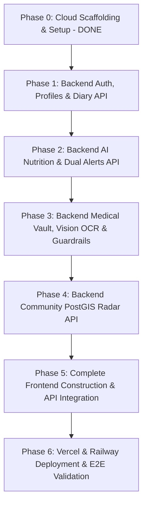

# PawCircle: Backend-First Implementation Plan

This roadmap translates the product specifications in [Pawcircle_ai_prd.md](file:///c:/Users/LENOVO/Desktop/PawCircle/Pawcircle_ai_prd.md) and the system design in [architecture.md](file:///c:/Users/LENOVO/Desktop/PawCircle/architecture.md) into an engineering sequence that builds and tests the **entire backend, AI pipelines, and database first**, followed by **frontend construction and full-stack integration at the end**.

---

## Roadmap Overview & Milestones

```
┌─────────────────────────────────────────────────────────────────────────────────────────────┐
│                            BACKEND-FIRST ENGINEERING ROADMAP                                │
├─────────────────────────┬──────────────────────────┬──────────────────────────┬─────────────┤
│ Phase 0 & Phase 1       │ Phase 2 & Phase 3        │ Phase 4                  │ Phase 5 & 6 │
│ Cloud Infra, Auth,      │ AI Nutrition & Medical   │ Community PostGIS Radar  │ React UI &  │
│ Diary APIs (Neon)       │ Vault APIs (HF Qwen)     │ & Meetup APIs            │ Deployments │
└─────────────────────────┴──────────────────────────┴──────────────────────────┴─────────────┘
```

| Phase | Scope | Focus Area | Deliverables |
| :--- | :--- | :--- | :--- |
| **Phase 0** | **Infra** | Cloud Scaffolding & Setup | Neon PostgreSQL with PostGIS, Hugging Face token, folder structure, `.gitignore`, requirements. *(Completed)* |
| **Phase 1** | **Backend** | Foundations, Auth & Diary API | Passwordless Magic Link/OTP, Location reverse-geocoding, Pet profile CRUD, 1-Tap Diary timeline endpoints. |
| **Phase 2** | **Backend** | AI Nutrition & Dual-Mode Alerts API | Caloric engine (RER/DER), Hugging Face Qwen2.5-VL diet generator, Celery/ARQ alert scheduler. |
| **Phase 3** | **Backend** | Medical Vault & Vision OCR API | Qwen2.5-VL prescription OCR, Vaccine card parser, Immunization roadmap, 4-tier LLM guardrail health chat. |
| **Phase 4** | **Backend** | PostGIS Community Radar API | Neon spatial proximity queries (`ST_DWithin`), Privacy fuzzy sanitizer, Meetup creation, Vaccine gate. |
| **Phase 5** | **Frontend** | React UI Construction & API Integration | Build all UI screens from provided designs, connect TanStack Query to backend APIs, PWA push listeners. |
| **Phase 6** | **Deploy** | Deployment & Full E2E Verification | Deploy React to Vercel, FastAPI to Railway, Streamlit companion app, and automated Playwright E2E tests. |

---

## Phase 0: Cloud Provisioning, Infrastructure & Setup (Completed)

- [x] **Neon Serverless PostgreSQL:** Connected and verified. `uuid-ossp` and `postgis` (v3.6) extensions enabled.
- [x] **Hugging Face Inference:** Account identified (`Tusharv05`), model targeted (`Qwen/Qwen2.5-VL-7B-Instruct`).
- [x] **Environment & Scaffolding:** Monorepo directory tree, `.gitignore`, `requirements.txt`, `.env.example`, `backend/railway.toml` (Nixpacks), and `smoke_test.py`.

---

## Phase 1: Backend Core, Passwordless Auth, Pet Profiles & 1-Tap Diary API

### Objective
Build and test the foundational backend services on FastAPI and Neon PostgreSQL: passwordless email OTP, reverse-geocoding, pet profile management, and daily activity diary event logging.

### Deliverables & Task Breakdown

#### 1. Database Migrations (Neon PostgreSQL)
- [ ] Create Alembic migration for `profiles` table:
  - Columns: `id`, `email`, `full_name`, `city`, `area_neighborhood`, `location_geom GEOGRAPHY(Point, 4326)`, `is_first_time_parent`, timestamps.
  - Add GiST index on `location_geom`.
- [ ] Create migration for `pets` table:
  - Columns: `id`, `owner_id`, `name`, `species`, `breed`, `birth_date`, `weight_kg`, `allergies`, `energy_level`, `play_style`, `is_neutered`, `vax_status`, `avatar_url`, timestamps.
- [ ] Create migration for `diary_events` table:
  - Columns: `id`, `pet_id`, `event_type` (`feed`, `walk`, `medication`, `water`, `poop`, `grooming`, `note`), `logged_at`, `details JSONB`, `notes`, `logged_by_sitter`.

#### 2. Authentication & Location Services
- [ ] **OTP Magic Link Service (`security.py` & `auth.py`):**
  - `POST /api/v1/auth/request-otp`: Issues secure 6-digit OTP stored in Redis/memory with a 5-minute TTL.
  - `POST /api/v1/auth/verify-otp`: Validates OTP, creates/retrieves user in Neon, returns signed JWT access token.
  - `GET /api/v1/auth/me`: Returns authenticated profile details.
- [ ] **Reverse-Geocoding Service (`geolocation.py`):**
  - `POST /api/v1/profiles/location`: Ingests `latitude` & `longitude`, queries OpenStreetMap Nominatim to resolve `city` and `area_neighborhood`, applies privacy fuzz factor, and writes `location_geom` to Neon.

#### 3. Pet Profile & Diary Timeline Endpoints
- [ ] **Pet CRUD (`endpoints/pets.py`):**
  - `POST /api/v1/pets`: Register a new pet with health baseline tags.
  - `GET /api/v1/pets`: List all pets for authenticated user.
  - `GET /api/v1/pets/{id}`: Fetch single pet profile.
  - `PUT /api/v1/pets/{id}`: Update pet stats (weight, allergies, energy level).
- [ ] **Daily Diary Endpoints (`endpoints/diary.py`):**
  - `POST /api/v1/diary/log`: 1-tap logging endpoint for `feed`, `walk`, `meds`, `water`, `poop`.
  - `GET /api/v1/diary/{pet_id}/today`: Returns aggregated activity timeline and streak for current 24h cycle.
  - `POST /api/v1/diary/{pet_id}/share-token`: Generates secure temporary read-only token for pet sitters.
  - `GET /api/v1/diary/shared/{token}`: Public read-only timeline endpoint for sitters.

#### 4. Backend Unit & Integration Tests
- [ ] Test OTP request and JWT authentication cycle.
- [ ] Test reverse-geocoding and location persistence in Neon.
- [ ] Test 1-tap diary event insertion and timeline retrieval.

---

## Phase 2: Backend AI Nutrition Engine, Qwen2.5-VL Diet Generator & Dual Meal Alerts API

### Objective
Implement the deterministic caloric calculation module (RER/DER math), integrate **`Qwen/Qwen2.5-VL-7B-Instruct`** for personalized meal generation, and build the dual-mode meal alert scheduling backend.

### Deliverables & Task Breakdown

#### 1. Deterministic Nutrition Engine (`nutrition_engine.py`)
- [ ] Implement biological Resting Energy Requirement:
  $$\text{RER} = 70 \times (\text{weight}_{\text{kg}})^{0.75}$$
- [ ] Implement Daily Energy Requirement (DER) multipliers:
  - Puppy/Kitten (< 4 mos): $3.0\times$ | Growing (> 4 mos): $2.0\times$
  - Intact Adult: $1.8\times$ | Neutered Adult: $1.6\times$
  - Weight Management: $1.0\times - 1.2\times$ | Senior: $1.1\times - 1.4\times$
- [ ] Hardcoded Toxic Ingredient Cross-Checker (Canine & Feline blacklists).

#### 2. Hugging Face Qwen2.5-VL Diet Generation Pipeline (`qwen_hf_service.py`)
- [ ] Formulate JSON schema enforcement prompt with pet stats, calculated target kcal, and allergy restrictions.
- [ ] Query Hugging Face inference API for `Qwen/Qwen2.5-VL-7B-Instruct`.
- [ ] Validate response with Pydantic: portion grams per feeding, meal schedule intervals, ingredient breakdown, species toxic list, and grooming cadence.

#### 3. Diet & Alert Endpoints (`endpoints/diet.py`)
- [ ] **Alembic Migrations:** Create `diet_plans` and `meal_schedules` tables in Neon.
- [ ] `POST /api/v1/diet/generate`: Accepts pet ID + optional prompt (e.g. *"Raw salmon cutting diet"*), runs math + Qwen2.5-VL, returns generated plan.
- [ ] `POST /api/v1/diet/adopt`: Commits generated plan as active in Neon and automatically inserts interval rows into `meal_schedules`.
- [ ] `GET /api/v1/diet/{pet_id}/current`: Fetches current active diet plan and portion targets.
- [ ] `PUT /api/v1/diet/{pet_id}/schedules`: Updates manual or AI meal times and portion notes.

#### 4. Dual-Mode Alert Background Worker (`alert_scheduler.py`)
- [ ] Background cron worker on Redis/Railway checking upcoming meal intervals.
- [ ] Web Push payload builder dispatching notifications with actionable flags (`[Mark Fed]` and `[Snooze 30m]`).

---

## Phase 3: Backend Smart Medical Vault, Multimodal Vision OCR & AI Health Chat API

### Objective
Deploy multimodal document intelligence using **`Qwen/Qwen2.5-VL-7B-Instruct`** on Hugging Face to parse prescriptions and vaccine cards, build the immunization roadmap engine, and deploy the 4-tier guardrailed health assistant.

### Deliverables & Task Breakdown

#### 1. Document Upload & Storage Integration (`storage.py`)
- [ ] S3 / Cloudflare R2 presigned URL generator for secure document upload and viewing.
- [ ] Image preprocessing utility: orientation correction, max dimension scaling (1536px), and Base64/URL encoding.

#### 2. Prescription Simplifier Pipeline
- [ ] **Alembic Migration:** Create `prescriptions` table in Neon.
- [ ] **Multimodal OCR Service:** Feed prescription image to Hugging Face Qwen2.5-VL to extract:
  - Clinical diagnosis.
  - Plain-language Grade 6 explanation.
  - Medications array: name, form, dosage, frequency, food requirements.
- [ ] `POST /api/v1/medical/prescriptions/upload`: Ingests image, runs vision extraction, stores in Neon, and returns parsed payload.
- [ ] `POST /api/v1/medical/prescriptions/{id}/create-alarms`: Converts extracted medication frequency into diary alarms.

#### 3. Vaccine Booklet Reader & Immunization Roadmap
- [ ] **Alembic Migration:** Create `vaccinations` table in Neon.
- [ ] **Vaccine OCR Service:** Extracts vaccine name, batch/lot number, administration date, and next booster date from photo. Detects clinic stamp to verify legitimacy.
- [ ] `POST /api/v1/medical/vaccines/upload`: Ingests card image and creates vaccination records.
- [ ] `GET /api/v1/medical/{pet_id}/roadmap`: Calculates puppy/kitten core immunization completion, returns **"Safe Walk Immunity Progress"** percentage and sets `is_verified` badge.

#### 4. Conversational Health Assistant with 4-Tier Guardrails (`guardrails.py`)
- [ ] **Tier 1: Pre-Retrieval Poison & Emergency Triage:**
  - Regex & token scan for red flags (*chocolate, xylitol, lilies, antifreeze, bloat, seizure*).
  - Bypasses LLM; instantly returns 24/7 pet emergency vet hotlines and local clinic data.
- [ ] **Tier 2: Context Grounding:**
  - Assembles pet profile, active prescriptions, vaccines, and recent diary logs from Neon.
- [ ] **Tier 3: Model Inference:**
  - Calls Hugging Face Qwen2.5-VL with non-diagnostic educator system persona.
- [ ] **Tier 4: Post-Generation Output Guardrail:**
  - Definitive diagnosis suppressor: Rewrites deterministic diagnosis claims into exploratory suggestions.
  - Prescription drug lock: Prohibits proposing unauthorized prescription dosages.
  - Mandatory clinical veterinary disclaimer appended to every answer.
- [ ] `POST /api/v1/medical/health-chat/stream`: Server-Sent Events (SSE) streaming chat endpoint.

---

## Phase 4: Backend Local Community Engine, PostGIS Spatial Radar & Meetup API

### Objective
Implement the privacy-first neighborhood pet radar using **Neon PostGIS** spatial indexing, event creation for pack walks, and verified vaccination RSVP gating.

### Deliverables & Task Breakdown

#### 1. Database Migrations (Neon PostGIS)
- [ ] Create `community_events` table in Neon with `event_geom GEOGRAPHY(Point, 4326)` and GiST index.
- [ ] Create `event_rsvps` table in Neon with unique constraint on `(event_id, pet_id)`.

#### 2. Fuzzy Privacy Geolocation Sanitizer
- [ ] Snapping algorithm: Before saving or returning coordinates, coordinates are snapped to neighborhood public park centroids within 500m radius.
- [ ] Strip residential coordinates and owner contact details from public responses.

#### 3. Community Endpoints (`endpoints/community.py`)
- [ ] `GET /api/v1/community/radar`:
  - Accepts `lat`, `lng`, `radius_km` (default 5km), and filters (`energy_level`, `species`, `size`).
  - Executes PostGIS spatial query (`ST_DWithin` and `ST_Distance`) returning nearby pets sorted by distance.
- [ ] `POST /api/v1/community/events`: Create pack walk or playdate meetup event.
- [ ] `GET /api/v1/community/events`: List upcoming events in user's city.
- [ ] `POST /api/v1/community/events/{id}/rsvp`:
  - Enforces attendee capacity limits.
  - **Vaccination Gate:** If `requires_verified_vax == true`, queries Neon `vaccinations` table for active Rabies/DHPP records; blocks RSVP if unverified.

---

## Phase 5: Complete Frontend Construction & Full-Stack Integration

### Objective
Once all backend endpoints and AI pipelines are built and verified, **construct the entire ReactJS PWA based directly on your provided screens and designs**, and wire up every interface with the live backend APIs.

### Deliverables & Task Breakdown

#### 1. Design System & Application Shell (React + Vite + TypeScript)
- [ ] Implement design tokens, typography, glassmorphism styling, and micro-animations.
- [ ] Create **Navigation Shell**:
  - Top Bar: Active pet switcher, notification bell, profile icon.
  - Bottom Bar (4 Core Tabs): **Diary**, **Nutrition & Care**, **Medical Vault**, **Community Radar**.
- [ ] Configure TanStack Query client, Zustand stores (`useAuthStore`, `usePetStore`), and Axios API client.

#### 2. Screen 1: Authentication & Onboarding
- [ ] Passwordless email input $\rightarrow$ 6-digit OTP verification modal.
- [ ] Location setup screen with browser GPS request + searchable manual city dropdown.
- [ ] Pet profile onboarding wizard: dog/cat selection, breed search, weight slider, allergy tags, experience toggle.

#### 3. Screen 2: Daily Activity Diary Tab
- [ ] 1-Tap Quick-Log Bar (`[Feed]`, `[Walk]`, `[Meds]`, `[Water]`) with tactile click feedback.
- [ ] Activity timeline feed with real-time updates and streak counter.
- [ ] Pet sitter share modal with copyable read-only link.

#### 4. Screen 3: AI Nutrition & Meal Alerts Tab
- [ ] 1-Tap preset chips (*"Puppy Growth"*, *"Senior Care"*) + custom text prompt bar.
- [ ] Structured Diet Card: Daily calorie target, morning/evening gram portions, ingredient list, species toxic food blacklist, and grooming cadence.
- [ ] Dual-mode schedule switcher: Manual fixed alarms vs. AI-calculated split intervals.
- [ ] 1-Tap **"Adopt this Schedule"** CTA button.

#### 5. Screen 4: Smart Medical Vault Tab
- [ ] Document capture & upload modal (camera snapshot or file upload).
- [ ] Prescription Translation Card: Tabbed comparison (*"Doctor's Rx"* vs *"Plain English Translation"*) + 1-Tap *"Set Medicine Alarms"* CTA.
- [ ] Vaccine Roadmap UI: Immunization timeline, booster countdown, and Safe Walk progress meter.
- [ ] AI Health Assistant chat interface with streaming responses and high-visibility red emergency poison banner.

#### 6. Screen 5: Local Community & Meetups Tab
- [ ] Interactive Leaflet radar map with fuzzy park-centered pins.
- [ ] Filter bar: Energy level (High, Moderate, Couch Potato), size, breed.
- [ ] Pack walk meetup event feed with RSVP toggle (`[Going]`, `[Interested]`).
- [ ] Vaccine verification lock modal preventing unverified pets from RSVPing.

#### 7. Service Worker & PWA Capabilities
- [ ] Service worker registration for Web Push alerts with actionable `[Mark Fed]` and `[Snooze 30m]` buttons.
- [ ] Offline caching for daily diary logging.

---

## Phase 6: Production Deployment, Hardening & End-to-End Testing

### Objective
Deploy the production stack to **Vercel** (Frontend) and **Railway** (Backend), verify the **Streamlit** companion app, conduct security audits, and execute automated end-to-end tests.

### Deliverables & Task Breakdown

#### 1. Deployment Execution
- [ ] **Deploy Backend to Railway:**
  - Connect GitHub repository `backend/`.
  - Configure `railway.toml` (Nixpacks builder) and `Procfile`.
  - Attach Railway Redis service.
  - Set Environment Variables (`DATABASE_URL`, `HF_TOKEN`, `REDIS_URL`, `JWT_SECRET`).
  - Verify `/api/v1/health` healthcheck.
- [ ] **Deploy Frontend to Vercel:**
  - Connect GitHub repository `frontend/`.
  - Configure `vercel.json` SPA rewrites.
  - Set `VITE_API_URL` environment variable pointing to Railway backend.
- [ ] **Deploy Streamlit Companion App:**
  - Connect `streamlit_app/` to Streamlit Community Cloud or Railway.

#### 2. End-to-End Automated Testing
- [ ] **Pytest Suite:** Complete coverage of Auth, Geolocation, Diet Math, Qwen2.5-VL JSON parsing, PostGIS queries, and Guardrails.
- [ ] **Playwright E2E Suite:** Automated browser testing:
  - User sign-up via OTP $\rightarrow$ Pet registration $\rightarrow$ 1-Tap Feed log $\rightarrow$ Diet generation $\rightarrow$ Prescription upload $\rightarrow$ Community radar discovery.

---

## Summary of the Backend-First Sequence


